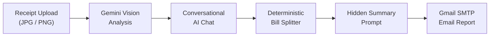

# ReceiptSnap AI

> **“Snap it. Understand it. Split it.”**

ReceiptSnap AI is an intelligent receipt understanding and bill-splitting web application powered by **Streamlit**, **Google Gemini Vision**, and **Gmail SMTP**. It transforms paper or digital receipts into structured, interactive breakdowns, allows users to ask conversational financial questions, calculates deterministic bill splits, and delivers clean summary reports straight to their inbox.

---

## Overview

Managing shared expenses, deciphering faded receipt thermal paper, and calculating per-person shares after group meals or shopping trips can be tedious and prone to human error.

**ReceiptSnap AI** solves this by combining multimodal Generative AI with deterministic financial arithmetic. Users simply upload a receipt image (JPG, JPEG, PNG), and Google Gemini Vision instantly extracts merchant details, timestamps, line items, taxes, discounts, and totals. 

Through an interactive chat interface, users can ask follow-up questions (such as *"What did we spend before tax?"* or *"Which item was the most expensive?"*), calculate fair bill splits across any group size, and send a structured Markdown summary directly to their email address.

---

## Features

- **Multimodal Receipt Analysis**: Directly processes receipt images using Google Gemini Vision (`types.Part.from_bytes`) to capture store names, line items, prices, taxes, and grand totals.
- **Conversational Follow-Up**: Persistent multi-turn chat session with contextual memory allows users to query receipt details without re-uploading.
- **Strict Uncertainty Handling**: Never hallucinates or fabricates receipt values. Incomplete or ambiguous data is clearly marked as *"Not clearly visible"* or labeled as an estimate.
- **Deterministic Bill Splitting**: Uses pure Python arithmetic for division and remainder reconciliation to ensure accurate calculations down to the cent/penny.
- **Automated Email Reports**: Generates professional email reports using an internal hidden summary prompt and delivers them via Gmail SMTP over SSL (port 465).
- **Session Privacy & Reset**: Lightweight in-memory session management via Streamlit `session_state` with a one-click session reset (`🔄 Start New Receipt`).

---

## How It Works



1. **Onboarding**: User enters name and email address (validated in session state).
2. **Receipt Upload**: Image bytes are packaged and passed to Gemini Vision with an optional custom prompt or default analysis instruction.
3. **Conversational Memory**: Gemini processes the image within a persistent chat session governed by a strict system prompt.
4. **Bill Splitting**: Pure Python calculations divide the total among group members and reconcile penny rounding remainders.
5. **Email Delivery**: A specialized hidden prompt synthesizes the entire conversation into a clean summary delivered via Gmail SMTP.

---

## Tech Stack

- **Frontend & App Framework**: [Streamlit](https://streamlit.io/)
- **AI & Vision Model**: [Google GenAI Python SDK](https://github.com/googleapis/python-genai) (`google-genai`) with Gemini Flash
- **Email Delivery**: Python Standard Library `smtplib` (`SMTP_SSL` port 465) & `email.message.EmailMessage`
- **Language**: Python 3.10+

---

## Project Structure

```text
receiptsnap-ai/
│
├── app.py                      # Main Streamlit application and UI logic
├── prompts.py                  # System instruction, welcome message & summary prompt
├── requirements.txt            # Minimal production dependencies
├── README.md                   # Comprehensive project documentation
├── .gitignore                  # Excludes secrets, virtual environments, and cache
│
└── .streamlit/
    └── secrets.toml.example    # Configuration template for API keys & SMTP credentials
```

---

## Local Setup & Installation

### 1. Clone or Open the Repository
```bash
cd receiptsnap-ai
```

### 2. Create a Virtual Environment
- **macOS / Linux**:
  ```bash
  python3 -m venv venv
  source venv/bin/activate
  ```
- **Windows (Command Prompt / PowerShell)**:
  ```powershell
  python -m venv venv
  .\venv\Scripts\activate
  ```

### 3. Install Dependencies
```bash
pip install -r requirements.txt
```

### 4. Configure Secrets
Copy the example configuration to create `.streamlit/secrets.toml`:
```bash
# Windows PowerShell:
Copy-Item .streamlit/secrets.toml.example .streamlit/secrets.toml

# macOS / Linux:
cp .streamlit/secrets.toml.example .streamlit/secrets.toml
```

Edit `.streamlit/secrets.toml` with your credentials:
```toml
GEMINI_API_KEY = "your-gemini-api-key-here"
GMAIL_ADDRESS = "your-email@gmail.com"
GMAIL_APP_PASSWORD = "your-16-character-app-password"
```

### 5. Run the Application
```bash
streamlit run app.py
```

The app will open in your browser at `http://localhost:8501`.

---

## Google Gemini API Setup

1. Visit [Google AI Studio](https://aistudio.google.com/).
2. Sign in with your Google account.
3. Click **Get API key** and generate a new key.
4. Copy the API key into your `.streamlit/secrets.toml` under `GEMINI_API_KEY`.

---

## Gmail SMTP Setup (App Password)

ReceiptSnap AI uses Gmail's secure SMTP server (`smtp.gmail.com:465`) with SSL. To configure it:

1. Sign in to your [Google Account](https://myaccount.google.com/).
2. Navigate to **Security** and ensure **2-Step Verification** is turned ON.
3. In the search bar at the top, search for **App passwords**.
4. Create a new app password (name it `ReceiptSnap AI`).
5. Copy the generated 16-character password (without spaces) and paste it into `.streamlit/secrets.toml` as `GMAIL_APP_PASSWORD`.
6. Set `GMAIL_ADDRESS` to your Gmail address.

> **Security Note**: Never use your standard personal Google password. Always use a Google App Password.

---

## Secrets Template Reference

```toml
# .streamlit/secrets.toml
GEMINI_API_KEY = "AIzaSy..."
GMAIL_ADDRESS = "alex.johnson@gmail.com"
GMAIL_APP_PASSWORD = "abcd efgh ijkl mnop"
```

---

## Deployment (Streamlit Community Cloud)

1. Push your repository to GitHub (ensure `.streamlit/secrets.toml` is ignored by `.gitignore`).
2. Log in to [Streamlit Community Cloud](https://share.streamlit.io/).
3. Click **New app**, select your repository, branch, and set main file to `app.py`.
4. Under **Advanced Settings** → **Secrets**, paste the contents of your `secrets.toml`:
   ```toml
   GEMINI_API_KEY = "your-gemini-api-key"
   GMAIL_ADDRESS = "your-email@gmail.com"
   GMAIL_APP_PASSWORD = "your-app-password"
   ```
5. Click **Deploy**.

---

## Security & Privacy

- **Zero Hard-Coded Credentials**: All API keys and email credentials are read dynamically from Streamlit secrets or system environment variables.
- **Git Protection**: `.streamlit/secrets.toml`, `.env`, and virtual environment directories are explicitly excluded in `.gitignore`.
- **In-Memory Session State**: User names, emails, and uploaded receipt images are stored exclusively in Streamlit's temporary `st.session_state` and are never written to an external database.
- **Safe Error Handling**: Network or authentication errors are caught and surfaced with friendly alerts without leaking stack traces or credentials.

---

## Limitations

- **Image Quality**: Faded, wrinkled, or severely blurred receipts may prevent accurate OCR extraction.
- **Handwritten Receipts**: Handwritten notes and irregular formats may result in items marked as *"Not clearly visible"*.
- **Financial Verification**: AI extractions are assistive estimates; users should always verify critical numbers against the physical receipt.
- **SMTP Dependencies**: Email dispatch requires an active internet connection and valid Google App Password credentials.

---

## Future Improvements

- Currency-aware automatic conversion for international travel.
- Multi-receipt monthly analytics and CSV export.
- Item-level assignment matrix for complex multi-person group splits.
- Direct PDF report export alongside email summaries.
- Spending category tagger (Dining, Groceries, Supplies).
